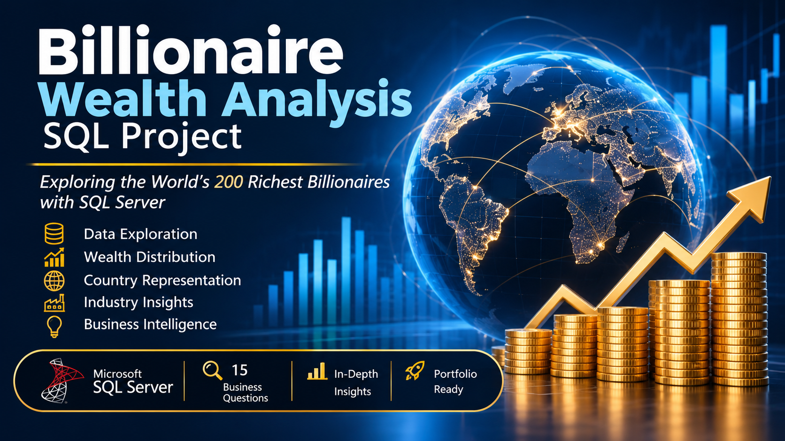

# BILLIONAIRE WEALTH ANALYSIS
An Exploratory SQL Data Analysis of the World's 200 Richest Billionaires


# INTRODUCTION


## Project Overview
- This project analyses a dataset containing information about the world's 200 richest billionaires.
- The aim is to investigate wealth distribution, individual net worth, age demographics, country representation and industry dominance using SQL Server.
- The project demonstrates how SQL can be used to explore structured data, answer business questions, identify patterns and communicate meaningful insights.

## The objectives of this project are to:
•	Identify the wealthiest individuals in the dataset.
•	Examine the age distribution of billionaires.
•	Calculate average age and net worth.
•	Investigate billionaire representation across countries.
•	Calculate combined wealth by country.
•	Identify industries with the highest billionaire representation.
•	Examine wealth distribution across age groups.
•	Compare average net worth across countries and industries.
•	Identify industries whose average wealth exceeds the overall dataset average.

## Dataset Description
- Dataset: Top 200 Richest Person in the World
- Number of records: 200
- Number of columns: 7
  
## Dataset columns
- serial_number:	Unique serial identifier
- rank:	Billionaire's ranking
- name:	Billionaire's name
- age:	Billionaire's age
- country:	Country associated with the billionaire
- networth_billion_US_dollars:	Net worth in billions of US dollars
- industry:	Industry associated with the billionaire

## Data types
•	serial_number: Integer
•	rank: Integer
•	name: Text
•	age: Integer
•	country: Text
•	networth_billion_US_dollars: Numeric
•	industry: Text

## Tools and Technologies
•	Microsoft SQL Server
•	SQL Server Management Studio (SSMS 22)
•	Microsoft Excel (data inspection and preparation)
•	GitHub (project documentation and portfolio presentation)

## Database Setup
- The dataset was imported into a SQL Server database named:
Billionaire_Wealth_Analysis
- The imported table is:
dbo.[Top 200 Richest Person in the World]
- The following database context is used for the analysis:
USE Billionaire_Wealth_Analysis;

## Business Questions and SQL Analysis

### BUSINESS QUESTION 1
Who are the 20 richest billionaires in the dataset?


Purpose: Identify the 20 individuals with the highest net worth.

### BUSINESS QUESTION 2
Who are the five youngest billionaires?


Purpose: Identify the youngest individuals in the dataset.

### BUSINESS QUESTION 3
What are the average age and average net worth of the 200 billionaires?

Purpose: Establish the average demographic and wealth profile.
Finding: The average age is 69.38 years, while the average net worth is approximately $31.84 billion.

### BUSINESS QUESTION 4
Which five countries have the highest number of billionaires?

Purpose: Identify the countries with the highest billionaire representation.

### BUSINESS QUESTION 5
What is the combined net worth of billionaires in each country?

Purpose: Compare the total wealth represented by each country.

### BUSINESS QUESTION 6
Which five industries have the highest number of billionaires?

Purpose: Identify the industries with the highest billionaire representation.

### BUSINESS QUESTION 7
Which countries have at least five billionaires?

Purpose: Identify countries meeting the minimum representation threshold.

### BUSINESS QUESTION 8
What is the total net worth of billionaires younger than 50?

Purpose: Calculate the combined wealth of billionaires below age 50.

### BUSINESS QUESTION 9
Which billionaires have a net worth above the overall average?

Purpose: Identify individuals whose net worth exceeds the overall dataset average.

### BUSINESS QUESTION 10
Which industry has the highest average net worth?

Purpose: Identify the industry with the highest average billionaire wealth.
________________________________________
## Additional Business Questions
The following questions extend the original analysis and provide deeper insights into wealth distribution.

### ADDITIONAL BUSINESS QUESTION 11
Which age group has the highest combined net worth?

Purpose: Compare the combined wealth of different age groups.

### ADDITIONAL BUSINESS QUESTION 12
How many billionaires belong to each age group?

Purpose: Understand the age composition of the dataset.

### ADDITIONAL BUSINESS QUESTION 13
Which country has the highest average billionaire net worth?

Purpose: Compare average billionaire wealth across countries.

### ADDITIONAL BUSINESS QUESTION 14
Which industry has the highest combined net worth?

Purpose: Identify the industry representing the greatest combined wealth.

### ADDITIONAL BUSINESS QUESTION 15
Which industries have an average net worth above the overall dataset average?

Purpose: Identify industries whose average billionaire wealth exceeds the overall average.
________________________________________
## Key SQL Concepts Applied
The project demonstrates the following SQL concepts:
- SELECT:	Retrieve specific columns
- TOP:	Limit returned records
- WHERE:	Filter individual records
- ORDER BY:	Sort query results
- GROUP BY:	Aggregate records into groups
- COUNT():	Count records
- SUM():	Calculate total wealth
- AVG():	Calculate average values
- HAVING:	Filter grouped results
- CASE WHEN:	Categorize billionaires by age
- BETWEEN:	Define age ranges
- Subqueries:	Compare individual and grouped results with an overall average
- Aliases:	Give calculated columns meaningful names

## Key Findings and Business Insights
This section is completed after I have executed actual SQL outputs.
The final analysis highlights:
1.	The wealthiest individuals in the dataset.
2.	The average age and net worth of the billionaires.
3.	Countries with the highest billionaire representation.
4.	Countries with the greatest combined billionaire wealth.
5.	Industries with the highest billionaire representation.
6.	The relationship between age groups and wealth distribution.
7.	Countries and industries with the highest average net worth.
8.	Industries whose average net worth exceeds the overall benchmark etc.
   
## Project Limitations
•	The analysis is based on only 200 individuals, not the entire global billionaire population.
•	The dataset represents a particular point in time and may not reflect current wealth rankings.
•	The analysis identifies patterns and associations but does not establish the causes of wealth differences.
•	Country and industry classifications depend on how the original dataset defines and records them.
•	Average values can be influenced by extremely high net worth observations.


## Conclusion
This project applies SQL to investigate wealth distribution among the 200 richest billionaires in the dataset.
Through structured queries and business-driven questions, the analysis explores individual wealth, demographic patterns, country representation and industry distribution.
The project also demonstrates the importance of translating raw query results into meaningful business insights.

 ## Repository Structure
Suggested GitHub repository layout:
```
Billionaire-Wealth-Analysis/

├── Dataset/
│   └── Top 200 Richest Person in the World.csv
│    
└── Project_Script/
│   ├── 200_Top_Billionaires
│    
└──Introductory_Image
├── README.md
```
________________________________________
Project Status: SQL analysis completed; findings verified and documented.

## About the Author

**Gideon Silas** is a Finance graduate, specializing at the intersection of corporate finance and modern data analytics. He is learning and building robust technical toolkits that allow him to transform raw enterprise data into strategic financial insights.

He enjoys turning messy business data into decisions people can act on, especially where finance and data meet.

- [LinkedIn](https://www.linkedin.com/in/gideonsilas)
- [Email](gideonmondaysilas@gmail.com)
- [More projects](https://wwww.github.com/Gideon-Silas)

*If you found this project useful, feel free to star the repository.*

